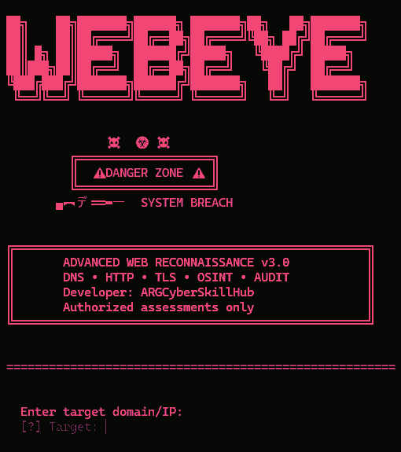

# WebEye — ReconScope Edition

<p align="center">
  
</p>

<p align="center">
  <strong>Python-based Web Reconnaissance & Basic Security Auditing</strong><br>
  DNS · HTTP · TLS · Security Headers · Robots/Sitemap · JSON Reports
</p>

**WebEye — ReconScope Edition** is an educational web-reconnaissance tool for authorized assessments and learning labs. It gathers basic public-facing configuration information and writes a JSON report.

> **Responsible use:** Only test domains and systems you own or are explicitly authorized to assess. Do not use this tool to disrupt services, bypass access controls, or access private data.

## Features

- DNS record lookup and IP resolution
- HTTP response status, final URL, response time, and selected headers
- Security-header presence checks
- TLS certificate subject, issuer, expiration, and negotiated TLS version
- `robots.txt` and `sitemap.xml` checks
- JSON report output
- Friendly error handling and configurable request timeout

## Requirements

- Python 3.10 or newer
- Network connection for live checks
- Permission to assess the target

## Installation

```bash
git clone https://github.com/BABLUSINGH85/WebEye.git
cd WebEye
python -m venv .venv
```

Activate the virtual environment:

**Kali Linux / Linux**
```bash
source .venv/bin/activate
```

**Windows PowerShell**
```powershell
.\.venv\Scripts\Activate.ps1
```

Install dependencies and run:

```bash
python -m pip install -r requirements.txt
python reconscope.py example.com --authorized --output report.json
```

Replace `example.com` with a target you own or have written permission to assess.

## Example

```bash
python reconscope.py example.com --output report.json --timeout 8
```

The report is saved to `report.json`. The script performs lightweight requests; it is not a vulnerability scanner and its output does not prove that a vulnerability exists.

## Tests

```bash
python -m unittest discover -s tests -v
```

## Project files

```text
WebEye/
├── reconscope.py
├── requirements.txt
├── pyproject.toml
├── README.md
├── LICENSE
├── screenshots/
│   └── webeye-banner.png
└── tests/
    └── test_webeye.py
```

## License

This edition is released under the MIT License included in this repository. The banner image is a user-provided screenshot reference, not a screenshot of ReconScope's current runtime output.

## Author

Maintained by **BABLUSINGH85**.

---

Original screenshot reference supplied by the repository owner. The project implementation and documentation here are a separate educational implementation.
